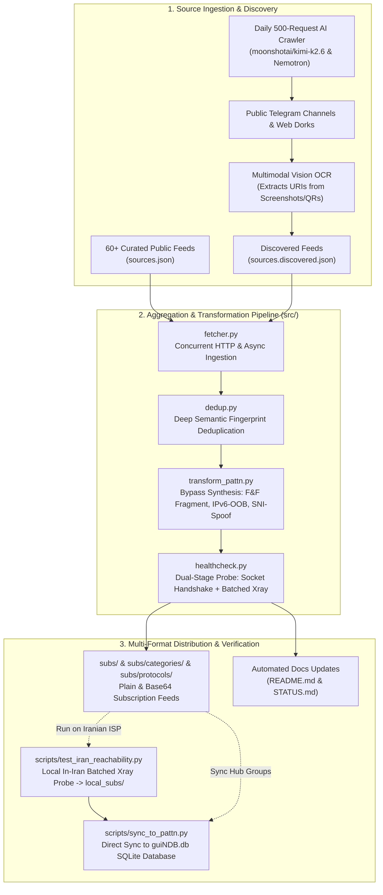

# 🌐 PattN - Autonomous High-Speed Proxy Aggregator & Censorship Circumvention Engine

[](https://github.com/mani-moh/pattn/actions/workflows/ci.yml) [](https://github.com/mani-moh/pattn/actions/workflows/update-subs.yml) [](https://github.com/mani-moh/pattn/actions/workflows/daily-deep-discovery.yml)  [](LICENSE) [](docs/ARCHITECTURE.md) [](STATUS.md) [](DISCOVERY.md)

> **PattN** is an enterprise-grade, fully autonomous proxy subscription aggregator and Iranian ISP censorship circumvention pipeline. Engineered specifically to overcome aggressive Deep Packet Inspection (DPI), SNI filtering, and protocol policing enforced across Iranian carriers (MCI, Irancell, Rightel, Shatel, Mokhaberat), PattN continuously harvests 60+ upstream feeds, executes semantic deduplication, synthesizes specialized Fast & Furious fragment and IPv6 out-of-band variants, performs multi-stage socket & real-traffic Xray health probes, and distributes categorized subscriptions for seamless import across all desktop and mobile clients.

**Last Refresh**: `2026-11-12 00:21:28 UTC` | **Total Public Nodes**: `62471` | **Verified Healthy**: `875` | **PattN Bypass Variants**: `1372`

---

## 📑 Table of Contents

- [1. Core Subscriptions](#-1-core-subscriptions)
- [2. Specialized Bypass Channels](#-2-specialized-bypass-channels)
- [3. Protocols & Top Country Channels](#-3-protocols--top-country-channels)
- [4. Under the Hood: System Architecture & How It Works](#-4-under-the-hood-system-architecture--how-it-works)
- [5. Complete Client Setup & Configuration Guides](#-5-complete-client-setup--configuration-guides)
  - [PattN Desktop (Windows)](#pattn-desktop-windows)
  - [v2rayN (Windows)](#v2rayn-windows)
  - [v2rayNG (Android)](#v2rayng-android)
  - [Clash Verge / Clash Meta (Windows, macOS, Linux)](#clash-verge--clash-meta-windows-macos-linux)
  - [sing-box / Nekobox (Android, iOS, Windows)](#sing-box--nekobox-android-ios-windows)
  - [Streisand / Shadowrocket / FoXray (iOS & macOS)](#streisand--shadowrocket--foxray-ios--macos)
- [6. Local In-Iran Verification Engine (`check_from_iran.ps1`)](#-6-local-in-iran-verification-engine-check_from_iranps1)
- [7. Real-World Use Cases & Scenarios](#-7-real-world-use-cases--scenarios)
- [8. Potential Problems, Failure Modes & Troubleshooting (The Fix-It Guide)](#-8-potential-problems-failure-modes--troubleshooting-the-fix-it-guide)
- [9. Automation Cadence & Repository Workflows](#-9-automation-cadence--repository-workflows)
- [10. CLI Reference & Developer Setup](#-10-cli-reference--developer-setup)
- [11. Security, Privacy & Integrity Guarantees](#-11-security-privacy--integrity-guarantees)
- [12. License & Acknowledgments](#-12-license--acknowledgments)

---

## 🚀 1. Core Subscriptions

These primary subscription groups are updated on an automated 6-hour schedule. Use these feeds for general browsing, high-throughput downloads, and everyday circumvention across any standard client:

| Feed | Description & Selection Criteria | Plain Subscription URL | Base64 Subscription URL | Active Nodes |
|---|---|---|---|:---:|
| **⭐ Verified** | Tested & responsive configs (passed live TCP/TLS socket verification or multi-round Xray probing). Latency sorted. | [`verified.txt`](https://raw.githubusercontent.com/mani-moh/pattn/master/subs/verified.txt) | [`verified_base64.txt`](https://raw.githubusercontent.com/mani-moh/pattn/master/subs/verified_base64.txt) | `875` |
| **⚡ Top 100** | The 100 lowest-latency verified nodes across all providers. Ideal for streaming and video calls. | [`top100.txt`](https://raw.githubusercontent.com/mani-moh/pattn/master/subs/top100.txt) | [`top100_base64.txt`](https://raw.githubusercontent.com/mani-moh/pattn/master/subs/top100_base64.txt) | `100` |
| **⚖️ Lite 500** | A balanced, round-robin mix of 500 nodes across all 6 protocols. Prevents client UI freezing and memory bloat on mobile. | [`lite500.txt`](https://raw.githubusercontent.com/mani-moh/pattn/master/subs/lite500.txt) | [`lite500_base64.txt`](https://raw.githubusercontent.com/mani-moh/pattn/master/subs/lite500_base64.txt) | `500` |
| **📦 All Configs** | Complete, semantically deduplicated aggregator output across all 60+ upstream sources. | [`all.txt`](https://raw.githubusercontent.com/mani-moh/pattn/master/subs/all.txt) | [`all_base64.txt`](https://raw.githubusercontent.com/mani-moh/pattn/master/subs/all_base64.txt) | `62471` |

> [!TIP]
> **Plain URL vs Base64 URL**: Most modern clients (PattN, v2rayN v6+, Clash Meta, sing-box, Nekobox) directly support **Plain Subscription URLs** (one node URI per line). If your client is an older build (legacy v2rayNG or older Shadowrocket) that requires a monolithic Base64 string, use the **Base64 Subscription URL** instead.

---

## 🛡️ 2. Specialized Bypass Channels

Engineered specifically for restrictive network environments, severe packet throttling, and active DPI filtering:

| Category | Technical Features & Bypasses | Plain Subscription URL | Base64 Subscription URL | Active Nodes |
|---|---|---|---|:---:|
| **🔥 PattN Special** | Fast & Furious TCP fragmentation (`fm=1`), IPv6 Out-of-Band dial (`dialMode=oob.0`), custom randomized cipher suites. Defeats SNI inspection. | [`pattn-special.txt`](https://raw.githubusercontent.com/mani-moh/pattn/master/subs/categories/pattn-special.txt) | [`pattn-special_base64.txt`](https://raw.githubusercontent.com/mani-moh/pattn/master/subs/categories/pattn-special_base64.txt) | `1372` |
| **🇮🇷 Iran Optimized** | Domestic routing optimization, low hop-count nodes, Clean IP fronting with minimal latency to Iranian border gateways. | [`iran-optimized.txt`](https://raw.githubusercontent.com/mani-moh/pattn/master/subs/categories/iran-optimized.txt) | [`iran-optimized_base64.txt`](https://raw.githubusercontent.com/mani-moh/pattn/master/subs/categories/iran-optimized_base64.txt) | `21249` |
| **🕶️ Reality** | VLESS-Reality TLS 1.3 direct SNI camouflage. Mimics genuine traffic to high-reputation foreign domains without custom SSL certificates. | [`reality.txt`](https://raw.githubusercontent.com/mani-moh/pattn/master/subs/categories/reality.txt) | [`reality_base64.txt`](https://raw.githubusercontent.com/mani-moh/pattn/master/subs/categories/reality_base64.txt) | `7624` |
| **☁️ CDN WS/gRPC** | WebSocket & gRPC reverse-proxied behind Cloudflare and global CDN edge nodes. Hides origin IP behind Anycast CDN networks. | [`cdn-ws-grpc.txt`](https://raw.githubusercontent.com/mani-moh/pattn/master/subs/categories/cdn-ws-grpc.txt) | [`cdn-ws-grpc_base64.txt`](https://raw.githubusercontent.com/mani-moh/pattn/master/subs/categories/cdn-ws-grpc_base64.txt) | `39896` |
| **🎯 ConfigsHUB** | Curated high-reputation daily channel extracts harvested from elite anti-censorship community channels. | [`confighub.txt`](https://raw.githubusercontent.com/mani-moh/pattn/master/subs/categories/confighub.txt) | [`confighub_base64.txt`](https://raw.githubusercontent.com/mani-moh/pattn/master/subs/categories/confighub_base64.txt) | `8595` |
| **⚡ Whitelist** | Clean IP / Whitelist bypass configs designed to punch through domestic intranet whitelist-only restrictions during national blackouts. | [`whitelist.txt`](https://raw.githubusercontent.com/mani-moh/pattn/master/subs/categories/whitelist.txt) | [`whitelist_base64.txt`](https://raw.githubusercontent.com/mani-moh/pattn/master/subs/categories/whitelist_base64.txt) | `535` |
| **🧩 Serverless JSON** | Ready-to-import Xray JSON outbounds array with embedded fragmentation rules. | [`serverless-fragment.json`](https://raw.githubusercontent.com/mani-moh/pattn/master/subs/categories/serverless-fragment.json) | *(Native JSON)* | `3367` |

---

## 📡 3. Protocols & Top Country Channels

### Protocol Feeds

| Protocol | Key Architectural Advantages | Plain Subscription URL | Base64 Subscription URL | Nodes |
|---|---|---|---|:---:|
| **VLESS** | Ultra-lightweight protocol without double encryption overhead. Native support for Reality, XTLS-Vision, and WebSocket/gRPC. | [`vless.txt`](https://raw.githubusercontent.com/mani-moh/pattn/master/subs/protocols/vless.txt) | [`vless_base64.txt`](https://raw.githubusercontent.com/mani-moh/pattn/master/subs/protocols/vless_base64.txt) | `42002` |
| **VMess** | Time-synchronized HMAC-authenticated protocol. Highly compatible across legacy and modern clients alike. | [`vmess.txt`](https://raw.githubusercontent.com/mani-moh/pattn/master/subs/protocols/vmess.txt) | [`vmess_base64.txt`](https://raw.githubusercontent.com/mani-moh/pattn/master/subs/protocols/vmess_base64.txt) | `8833` |
| **Trojan** | Disguises proxy traffic as standard TLS 1.3 HTTPS web browsing over standard port 443. Resistant to active probing. | [`trojan.txt`](https://raw.githubusercontent.com/mani-moh/pattn/master/subs/protocols/trojan.txt) | [`trojan_base64.txt`](https://raw.githubusercontent.com/mani-moh/pattn/master/subs/protocols/trojan_base64.txt) | `6346` |
| **Shadowsocks** | High-performance AEAD encryption (`2022-blake3`, `chacha20-poly1305`, `aes-gcm`). Minimal handshake overhead. | [`ss.txt`](https://raw.githubusercontent.com/mani-moh/pattn/master/subs/protocols/ss.txt) | [`ss_base64.txt`](https://raw.githubusercontent.com/mani-moh/pattn/master/subs/protocols/ss_base64.txt) | `4292` |
| **Hysteria2** | UDP-based QUIC protocol with custom BBR congestion control. Bypasses TCP packet loss throttling on unstable cellular connections. | [`hysteria2.txt`](https://raw.githubusercontent.com/mani-moh/pattn/master/subs/protocols/hysteria2.txt) | [`hysteria2_base64.txt`](https://raw.githubusercontent.com/mani-moh/pattn/master/subs/protocols/hysteria2_base64.txt) | `632` |
| **TUIC** | Modern QUIC implementation engineered for minimal RTT and 0-RTT handshakes over lossy cellular networks. | [`tuic.txt`](https://raw.githubusercontent.com/mani-moh/pattn/master/subs/protocols/tuic.txt) | [`tuic_base64.txt`](https://raw.githubusercontent.com/mani-moh/pattn/master/subs/protocols/tuic_base64.txt) | `9` |

### Top Geographic Channels (Latency & Geo-Targeting)

Grouped automatically for localized services (Google Search region, European streaming, low-ping routing):

| Country Code | Plain Subscription URL | Base64 Subscription URL | Active Nodes |
|---|---|---|:---:|
| **US** | [`us.txt`](https://raw.githubusercontent.com/mani-moh/pattn/master/subs/countries/us.txt) | [`us_base64.txt`](https://raw.githubusercontent.com/mani-moh/pattn/master/subs/countries/us_base64.txt) | `8688` |
| **IR** | [`ir.txt`](https://raw.githubusercontent.com/mani-moh/pattn/master/subs/countries/ir.txt) | [`ir_base64.txt`](https://raw.githubusercontent.com/mani-moh/pattn/master/subs/countries/ir_base64.txt) | `3336` |
| **DE** | [`de.txt`](https://raw.githubusercontent.com/mani-moh/pattn/master/subs/countries/de.txt) | [`de_base64.txt`](https://raw.githubusercontent.com/mani-moh/pattn/master/subs/countries/de_base64.txt) | `2791` |
| **CA** | [`ca.txt`](https://raw.githubusercontent.com/mani-moh/pattn/master/subs/countries/ca.txt) | [`ca_base64.txt`](https://raw.githubusercontent.com/mani-moh/pattn/master/subs/countries/ca_base64.txt) | `1765` |
| **FR** | [`fr.txt`](https://raw.githubusercontent.com/mani-moh/pattn/master/subs/countries/fr.txt) | [`fr_base64.txt`](https://raw.githubusercontent.com/mani-moh/pattn/master/subs/countries/fr_base64.txt) | `1494` |
| **RU** | [`ru.txt`](https://raw.githubusercontent.com/mani-moh/pattn/master/subs/countries/ru.txt) | [`ru_base64.txt`](https://raw.githubusercontent.com/mani-moh/pattn/master/subs/countries/ru_base64.txt) | `1307` |
| **NL** | [`nl.txt`](https://raw.githubusercontent.com/mani-moh/pattn/master/subs/countries/nl.txt) | [`nl_base64.txt`](https://raw.githubusercontent.com/mani-moh/pattn/master/subs/countries/nl_base64.txt) | `1261` |
| **GB** | [`gb.txt`](https://raw.githubusercontent.com/mani-moh/pattn/master/subs/countries/gb.txt) | [`gb_base64.txt`](https://raw.githubusercontent.com/mani-moh/pattn/master/subs/countries/gb_base64.txt) | `985` |
| **CC** | [`cc.txt`](https://raw.githubusercontent.com/mani-moh/pattn/master/subs/countries/cc.txt) | [`cc_base64.txt`](https://raw.githubusercontent.com/mani-moh/pattn/master/subs/countries/cc_base64.txt) | `892` |
| **HK** | [`hk.txt`](https://raw.githubusercontent.com/mani-moh/pattn/master/subs/countries/hk.txt) | [`hk_base64.txt`](https://raw.githubusercontent.com/mani-moh/pattn/master/subs/countries/hk_base64.txt) | `749` |
| **SG** | [`sg.txt`](https://raw.githubusercontent.com/mani-moh/pattn/master/subs/countries/sg.txt) | [`sg_base64.txt`](https://raw.githubusercontent.com/mani-moh/pattn/master/subs/countries/sg_base64.txt) | `723` |
| **CD** | [`cd.txt`](https://raw.githubusercontent.com/mani-moh/pattn/master/subs/countries/cd.txt) | [`cd_base64.txt`](https://raw.githubusercontent.com/mani-moh/pattn/master/subs/countries/cd_base64.txt) | `710` |

---

## 🔬 4. Under the Hood: System Architecture & How It Works



### How PattN Overcomes Modern DPI Censorship

1. **Semantic Deduplication**: Upstream aggregators flood users with hundreds of duplicate links that have slightly different remark labels or URI-encoded query strings. PattN parses nodes into an abstract syntax model (`ProxyNode`), computes an invariant hash of `(protocol, host, port, path, transport, security, clean_credentials)`, and deduplicates over 90% of redundant entries while combining tags and preserving source provenance.
2. **Fast & Furious TCP Fragmentation (`fm=1`)**: Iranian DPI middleboxes inspect the TLS ClientHello packet looking for blacklisted domain names in the SNI extension. PattN's variant generator injects TCP fragmentation parameters that split the ClientHello across 1-byte TCP window segments or custom byte offsets. Because the middlebox cannot reassemble the fragmented TCP stream in real-time, the SNI check is completely bypassed while the foreign endpoint reassembles the TCP packet flawlessly.
3. **IPv6 Out-of-Band (`dialMode=oob.0`)**: In scenarios where IPv4 domestic routes are heavily choked or SNI-poisoned, PattN creates out-of-band routing variants that instruct the Xray core to dial the upstream target via IPv6 while maintaining the domestic IPv4 client tunnel.
4. **Dual-Mode Multi-Round Health Checks**: Rather than trusting upstream tags or performing naive ping checks (which pass even when DPI actively resets TLS handshakes), PattN utilizes non-blocking socket handshakes in CI, combined with local batched Xray core real-traffic HTTP tests using multi-round survival intersection to eliminate transient packet loss.
5. **Autonomous Daily Deep Discovery**: Powered by NVIDIA NIM frontier AI models (`moonshotai/kimi-k2.6`, `mistralai/mistral-large-4-1t-a52b`, and `nvidia/nemotron-3.5-super-vl-120b-a12b`), PattN executes an autonomous 500-request deep crawl daily at 02:00 UTC. It mines Telegram channel trees, scans GitHub repos, runs OCR extraction on proxy screenshot images, and records new high-quality feeds into persistent state.

---

## 📱 5. Complete Client Setup & Configuration Guides

### PattN Desktop (Windows)

PattN Desktop features seamless native integration with this repository via direct SQLite database synchronization.

1. **Automated One-Click Database Sync**:
   - Open PowerShell inside the repository directory.
   - Run the synchronization script:
     ```powershell
     python scripts/sync_to_pattn.py --disable-redundant
     ```
   - This automatically creates a timestamped backup of your database (`guiNDB.db.bak.<timestamp>`), upserts all standardized PattN Hub groups, and disables obsolete feeds.
2. **Manual Subscription Group Setup**:
   - Open PattN Desktop -> Navigate to **Subscriptions** -> **Add Subscription Group**.
   - **Remarks**: `⭐ PattN Hub - Verified`
   - **URL**: `https://raw.githubusercontent.com/mani-moh/pattn/master/subs/verified.txt`
   - Click **Save**, right-click the group, and select **Update Subscriptions**.
3. **Recommended Settings**:
   - **Core Type**: `Xray` (latest patterniha release).
   - **Routing Mode**: `Bypass LAN and Mainland/Iran` (routes domestic `.ir` websites and banks direct, foreign traffic through proxy).
   - **System Proxy Mode**: `Enable System Proxy` or `TUN Mode` for system-wide routing.

---

### v2rayN (Windows)

1. Open **v2rayN** (v6+ recommended).
2. Click **Subscription Group** (top toolbar) -> **Subscription Group Setting**.
3. Click **Add** in the bottom-left corner:
   - **Remarks**: `PattN Verified`
   - **Optional URL**: `https://raw.githubusercontent.com/mani-moh/pattn/master/subs/verified.txt`
   - **Auto-Update**: Check `Enabled` and set update interval to `360` minutes (6 hours).
4. Click **Confirm**.
5. Click **Subscription Group** -> **Update subscription without proxy**.
6. In the bottom bar, set **Routing Rule** to `Bypass Iran and LAN` (`geoip:ir` and `geosite:ir` -> direct).
7. Right-click any node in the list and select **Set as active server** (`Enter`), then toggle **Enable System Proxy** (`Ctrl + R`).

---

### v2rayNG (Android)

1. Open **v2rayNG** on your Android device.
2. Tap the **≡ (Menu)** icon in the top-left corner -> Select **Subscription group setting**.
3. Tap the **+** button in the top-right corner:
   - **Remarks**: `PattN Lite 500` (or `PattN Verified`)
   - **Subscription URL**: `https://raw.githubusercontent.com/mani-moh/pattn/master/subs/lite500.txt`
4. Tap the **✓ (Save)** icon in the top-right corner.
5. Return to the main screen, tap the **⋮ (Three Dots)** in the top-right corner -> Select **Update subscription**.
6. **Routing Configuration**:
   - Go to **Settings** -> **Routing rules** -> Select `Bypass LAN and mainland`.
   - Enable **Domain Strategy** -> Select `IPIfNonMatch`.
   - Enable **Sniffing** to ensure correct domain routing.
   - Enable **Per-App Proxy** if you only wish to route specific applications (e.g. YouTube, Instagram, Telegram).
7. Tap the floating **V** button to connect.

---

### Clash Verge / Clash Meta (Windows, macOS, Linux)

1. Open **Clash Verge Rev** or **Clash Meta**.
2. Navigate to **Profiles** -> Paste the subscription URL into the **Profile URL** box:
   - URL: `https://raw.githubusercontent.com/mani-moh/pattn/master/subs/verified.txt`
   - *(Note: If using standard Clash, import through an online or local SubConverter service with target `clash`).*
3. Alternatively, add PattN directly to your custom `config.yaml` as a proxy-provider:
   ```yaml
   proxy-providers:
     pattn-verified:
       type: http
       url: "https://raw.githubusercontent.com/mani-moh/pattn/master/subs/verified.txt"
       path: ./profiles/providers/pattn-verified.yaml
       interval: 21600
       health-check:
         enable: true
         url: http://cp.cloudflare.com/generate_204
         interval: 300
   ```
4. Switch to **Rule Mode** and ensure rules include `GEOIP,IR,DIRECT` and `GEOSITE,category-ir,DIRECT`.

---

### sing-box / Nekobox (Android, iOS, Windows)

1. Open **NekoBox** (or sing-box GUI client).
2. Navigate to **Groups** -> Tap **+ (Add Group)**.
3. **Group Name**: `PattN Special Bypass`
4. **Group Type**: `Subscription`
5. **Subscription Link**: `https://raw.githubusercontent.com/mani-moh/pattn/master/subs/categories/pattn-special.txt`
6. Tap **Confirm** -> Long press the newly created group -> Select **Update**.
7. In Settings, select **TUN Mode Implementation** -> `gVisor` (or `System`).
8. Set **Route Mode** to `Bypass LAN and Iran`.

---

### Streisand / Shadowrocket / FoXray (iOS & macOS)

1. Open **Shadowrocket** or **Streisand**.
2. Tap the **+** icon in the top right:
   - **Type**: `Subscribe`
   - **URL**: `https://raw.githubusercontent.com/mani-moh/pattn/master/subs/lite500.txt`
   - **Remark**: `PattN Lite`
3. Tap **Save** -> The client will download and parse all nodes automatically.
4. In **Global Routing**, select `Config` or `Rule` (ensuring default ruleset bypasses Iranian IP blocks).
5. Tap the test button to ping all nodes, select the fastest response, and toggle the connection switch.

---

## 🇮🇷 6. Local In-Iran Verification Engine (`check_from_iran.ps1`)

> [!IMPORTANT]
> **Why Test Directly from Iran?**  
> GitHub Actions runners are hosted in international Azure/AWS cloud datacenters (US, UK, Germany) with unfiltered 10 Gbps uplinks.  
> A node that appears green and low-latency in GitHub Actions can be actively SNI-filtered or UDP-blackholed by Iranian DPI middleboxes (MCI, Irancell, Shatel).  
> PattN provides a local, real-traffic verification engine to test configs on your genuine domestic ISP connection.

### How to Run In-Iran Verification

1. **Disconnect your personal VPN / TUN proxy completely** so your connection exits directly via your Iranian ISP.
2. Open a PowerShell prompt in the repository folder.
3. Run the automated tester:
   ```powershell
   .\scripts\check_from_iran.ps1
   ```
   - *Optional flags*:
     - `-MaxNodes 800`: Test up to 800 prioritized candidate configs.
     - `-Rounds 3`: Enforce 3 consecutive successful probe rounds to eliminate false positives.
     - `-FromGitHub`: Pull the latest raw subscriptions from GitHub before testing.
     - `-NoDbSync`: Skip auto-syncing survivors to PattN desktop GUI database.
4. **What the Script Does**:
   - Verifies that no active VPN/proxy is masking your IP (safety guard).
   - Automatically locates your local Xray core (`xray.exe`).
   - Launches concurrent batches of outbounds, sending real HTTP probe traffic through each proxy node.
   - Generates git-ignored, live-verified feeds at:
     - `local_subs/iran_verified.txt`
     - `local_subs/iran_verified_base64.txt`
   - Automatically registers `🇮🇷 PattN Hub - Iran Live Verified` at the very top of your local PattN Desktop database (`guiNDB.db`).

---

## 🎯 7. Real-World Use Cases & Scenarios

| Scenario / Use Case | Recommended Subscription | Recommended Protocol | Why This Combination Works |
|---|---|---|---|
| **4K Video Streaming & Entertainment** (YouTube, Twitch, Netflix) | [`top100.txt`](https://raw.githubusercontent.com/mani-moh/pattn/master/subs/top100.txt) | VLESS Reality / Trojan | Lowest latency with maximum sustained throughput and low jitter. |
| **Mobile Cellular on Strict DPI** (MCI / Irancell / Rightel) | [`pattn-special.txt`](https://raw.githubusercontent.com/mani-moh/pattn/master/subs/categories/pattn-special.txt) | VLESS Fast & Furious Fragment (`fm=1`) | Splits TLS ClientHello across packets, evading carrier-level SNI keyword filters. |
| **Competitive Online Gaming & Discord Voice** | [`hysteria2.txt`](https://raw.githubusercontent.com/mani-moh/pattn/master/subs/protocols/hysteria2.txt) or [`tuic.txt`](https://raw.githubusercontent.com/mani-moh/pattn/master/subs/protocols/tuic.txt) | Hysteria2 / TUIC (QUIC UDP) | Eliminates TCP head-of-line blocking; custom congestion control maintains low ping during packet loss. |
| **Developer Tools & Package Managers** (`docker pull`, `pip`, `npm`, `cargo`, Hugging Face) | [`verified.txt`](https://raw.githubusercontent.com/mani-moh/pattn/master/subs/verified.txt) | Cloudflare CDN WS/gRPC or Reality | Resilient Anycast routing with zero dropped TLS handshakes during large multi-GB layer downloads. |
| **Severe Censorship & National Intranet Conditions** (National Blackout / Melli Net) | [`whitelist.txt`](https://raw.githubusercontent.com/mani-moh/pattn/master/subs/categories/whitelist.txt) & [`serverless-fragment.json`](https://raw.githubusercontent.com/mani-moh/pattn/master/subs/categories/serverless-fragment.json) | Whitelist Clean IP / Fragment | Leverages domestic serverless edge addresses and white-listed port ranges to punch through severe firewalls. |

---

## 🛠️ 8. Potential Problems, Failure Modes & Troubleshooting (The Fix-It Guide)

### 1. "All nodes show 9999ms or Timed Out in client"
- **Root Cause A: Clock Drift**: Xray VMess and TLS protocols require system time to be accurate within 90 seconds. If your Windows or Android clock has drifted, all handshakes fail cryptographically.
  - *Fix*: On Windows, open PowerShell as Admin and run: `w32tm /resync`. On Android, enable **Automatic Date & Time** in system settings.
- **Root Cause B: Routing Loop**: Client is routing DNS queries or proxy tunnel traffic through the proxy itself before the connection is established.
  - *Fix*: In v2rayN/v2rayNG, set DNS server to `1.1.1.1` or `8.8.8.8` and set Domain Strategy to `IPIfNonMatch`.

### 2. "tls: handshake failure" or "remote error: tls: bad certificate" on Reality nodes
- **Root Cause**: The destination camouflage domain configured in `sni` or `pbk` has been actively throttled or blocked by your Iranian ISP gateway.
- *Fix*: Switch to `pattn-special.txt` or `iran-optimized.txt`. These feeds synthesize multiple SNI alternatives and TCP fragmentations to prevent ISP SNI blocking.

### 3. "Cloudflare Error 1000 / 1015 / 1020 on CDN nodes"
- **Root Cause**: The Cloudflare edge IP is rate-limited or blocked by Cloudflare anti-bot WAF rules.
- *Fix*: Replace the host IP address in your client with a known Clean Cloudflare IP (e.g. `104.16.0.0/12` or `188.114.96.0/20` ranges) while preserving the original `host` header and `path` parameters.

### 4. "Config works on Shatel/Mokhaberat Wi-Fi but fails completely on MCI or Irancell mobile data"
- **Root Cause**: Iranian mobile operators (MCI, Irancell) enforce aggressive UDP traffic throttling (breaking standard QUIC/Hysteria) and deeper TCP window inspection compared to fixed-line ADSL/VDSL providers.
- *Fix*: On cellular connections, prefer **VLESS Fast & Furious Fragment** (`pattn-special.txt`) over port 443 TCP rather than UDP protocols.

### 5. "Domestic Iranian Apps (Banking, Snapp, Digikala) won't load or block login"
- **Root Cause**: Your client is routing Iranian traffic through the foreign proxy tunnel. Iranian banking gateways block connections coming from foreign data centers.
- *Fix*: Ensure your client routing rule is set to **Bypass LAN and Iran** (`geoip:ir` and `geosite:ir` configured as `direct`).

### 6. "guiNDB.db is locked" or SQLite Database Error in PattN
- **Root Cause**: Another instance of PattN or a background sync script holds an open write transaction on the database.
- *Fix*: Close PattN Desktop before running `python scripts/sync_to_pattn.py`, or ensure `scripts/sync_to_pattn.py` has completed its automated backup.

---

## ⏰ 9. Automation Cadence & Repository Workflows

PattN operates on a high-reliability, two-tier automation architecture:

1. **6-Hour Fast Scheduled Refresh (`.github/workflows/update-subs.yml`)**:
   - **Trigger**: Every 6 hours (`0 */6 * * *`).
   - **Action**: Concurrently aggregates all 60+ upstream feeds, runs deep semantic deduplication, synthesizes PattN bypass variants, performs socket & Xray health testing, and commits refreshed subscription files and documentation.
   - **Design**: Fast and lean — operates without heavy AI inference overhead to guarantee 100% reliability.
2. **Daily Extended AI Discovery (`.github/workflows/daily-deep-discovery.yml`)**:
   - **Trigger**: Daily at 02:00 UTC (`0 2 * * *`).
   - **Action**: Runs the autonomous frontier AI discovery engine powered by `moonshotai/kimi-k2.6` (with automatic failover to `mistralai/mistral-large` and `nvidia/nemotron-3.5-super-vl`).
   - **Capacity**: Executes up to **500 API requests**, discovers dozens of candidate Telegram channels and GitHub repos, runs OCR extraction on proxy screenshot images, filters dead channels, and records persistent state into `sources.discovered.json` and `data/discovery_state.json`.
3. **Continuous Integration & Security Gate (`.github/workflows/ci.yml`)**:
   - **Trigger**: Every git push and pull request.
   - **Action**: Executes Python byte-compilation across Python `3.10` and `3.12`, runs the complete 65-test unit & integration test suite, and runs a zero-tolerance static secret scan.

---

## 💻 10. CLI Reference & Developer Setup

### Developer Setup

```bash
# 1. Clone the repository
git clone https://github.com/mani-moh/pattn.git
cd pattn

# 2. Configure local environment (optional for AI discovery)
cp .env.example .env
# Add NVIDIA_API_KEY in .env if you wish to run local AI discovery

# 3. Run full unit and integration test suite
python -m compileall -q src scripts tests
python -m unittest discover -s tests -v
```

### CLI Command Matrix

| Task / Operation | CLI Command | Description |
|---|---|---|
| **Full Aggregation Pipeline** | `python -m src.main` | Runs full aggregation with socket health checking, PattN variants, and docs generation. |
| **Fast Aggregation (No Probes)** | `python -m src.main --no-healthcheck` | Aggregates and categorizes all sources instantly without socket wait times. |
| **Daily Extended AI Discovery** | `python -m src.main --discover-only --discovery-api-requests 500 --discovery-time 5400` | Runs deep 500-request AI discovery crawl for up to 90 minutes. |
| **Quick AI Discovery Cycle** | `python -m src.main --discover-only --discovery-time 360` | Runs a 6-minute targeted Telegram/Web crawl and updates `sources.discovered.json`. |
| **In-Iran Xray Reachability Test** | `.\scripts\check_from_iran.ps1` | Runs local batched Xray probe through Iranian ISP and outputs to `local_subs/`. |
| **Sync to PattN Desktop DB** | `python scripts/sync_to_pattn.py --disable-redundant` | Backs up and syncs PattN Hub subscription groups into `guiNDB.db`. |
| **Manual Actions Workflow Trigger** | `.\scripts\trigger_update.ps1 -Local -SyncPattnDb` | Runs the full pipeline locally and syncs to PattN DB in a single command. |

---

## 🔒 11. Security, Privacy & Integrity Guarantees

- **Zero Leaks**: All private configurations, personal tokens, and API credentials are kept strictly out of git-tracked files. Local verification outputs are restricted to git-ignored `local_subs/`.
- **CI Secret Scanning**: Every pull request and push is checked by an automated static secret scanner in `.github/workflows/ci.yml` that blocks API key patterns and untracked file exposure.
- **Deterministic Reproducibility**: Pure Python core logic without external runtime dependencies (requests, beautifulsoup, or heavy web frameworks) — runs on vanilla Python 3.10+ standard library.

---

## 📄 12. License & Acknowledgments

- **License**: Released under the permissive [MIT License](LICENSE).
- **Upstream Cores**: Powered by [patterniha/Xray-core](https://github.com/patterniha/Xray-core) and the global anti-censorship open-source community.
- **AI Models**: Frontier reasoning and multimodal vision powered by [NVIDIA NIM](https://build.nvidia.com) (`moonshotai/kimi-k2.6`, `mistralai/mistral-large`, and `nvidia/nemotron-3.5-super-vl`).

---

*Maintained with ❤️ by the PattN Engineering Community. Star ⭐ the repository to support unrestricted, open internet access.*